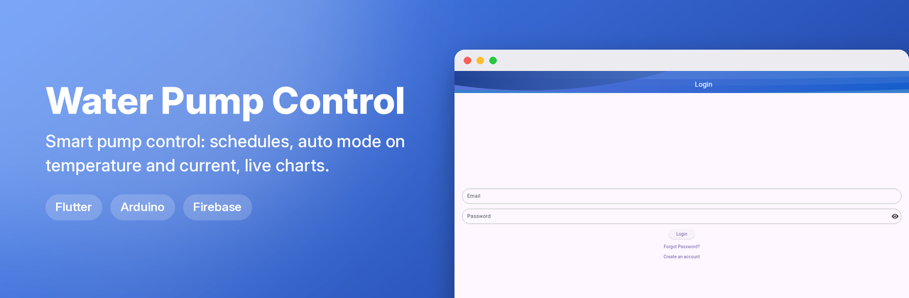
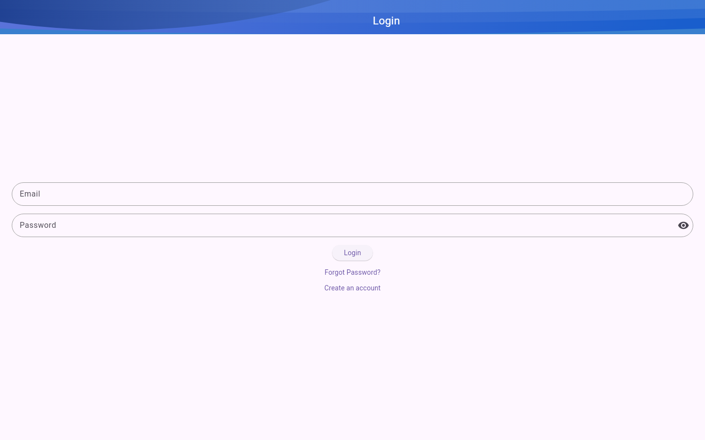
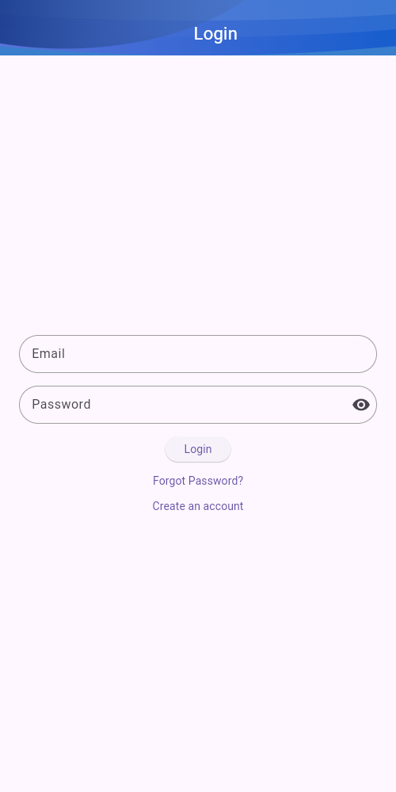

**▶ Live demo: [mohamedbenhmida-waterpump.web.app](https://mohamedbenhmida-waterpump.web.app)**

> The web demo shows the interface only: sign-in, push alerts and pump control need the Android app and the hardware.

  
  

💧 Water Pump Control System

This project combines a Flutter mobile application and Arduino-based hardware to control a water pump with advanced features, such as automatic operation based on temperature and current, scheduling, authentication, and historical data visualization using charts.

The project uses Firebase for user authentication, real-time monitoring (RTDB), and data storage (Firestore).

🚀 Features

Flutter Mobile App
	•	Control Water Pump:
	•	Turn the water pump ON/OFF manually.
	•	Automatic control based on temperature and current values.
	•	Schedule Operations:
	•	Schedule water pump operation with specific time intervals.
	•	Live Monitoring:
	•	View real-time temperature and current readings.
	•	Authentication:
	•	Secure login and registration using Firebase Authentication.
	•	History Visualization:
	•	View historical temperature and current data using charts.
	•	Data stored in Firestore for persistence.
	•	User-friendly Interface:
	•	Clean and intuitive UI with smooth navigation.

Arduino Code
	•	Sensor Integration:
	•	Reads temperature and current values using appropriate sensors.
	•	Pump Control:
	•	Controls water pump operation based on conditions sent from the Flutter app.
	•	Wi-Fi Communication:
	•	Sends real-time sensor data and accepts control commands.

🛠️ Technologies Used

Frontend (Flutter):
	•	Flutter SDK for cross-platform mobile app development.
	•	Firebase for:
	•	Authentication (Login/Signup).
	•	Real-Time Database for live sensor updates.
	•	Firestore for historical data storage.

Backend (Arduino):
	•	Arduino IDE for coding.
	•	Sensors for temperature and current measurement.
	•	Relay module for water pump control.

Charts:
	•	Flutter chart libraries for visualizing historical data.

📱 App Screenshots
	1.	Authentication Screen (Login/Signup).
	2.	Control Dashboard:
	•	Live temperature/current values.
	•	Pump ON/OFF toggle.
	3.	Schedule Screen:
	•	Set specific pump operation times.
	4.	History Screen:
	•	Charts showing temperature/current trends.

🛠️ Hardware Requirements
	•	Water Pump (controlled via a relay module).
	•	Arduino Board (e.g., Uno, Mega).
	•	Temperature Sensor (e.g., DHT11 or DS18B20).
	•	Current Sensor (e.g., ACS712).
	•	Relay Module for pump control.
	•	HC-05 Bluetooth Module (if using Bluetooth).
	•	Wi-Fi Module (e.g., ESP8266 or ESP32) for real-time communication.

💻 Setup Instructions

1. Flutter App
	1.	Clone the repository:

git clone https://github.com/mohamedbnhmida/WaterPumpControl.git
cd WaterPumpControl

	2.	Install Flutter dependencies:

flutter pub get

	3.	Set up Firebase:
	•	Add your Firebase project credentials to the app (google-services.json for Android, GoogleService-Info.plist for iOS).
	•	Enable Authentication, Firestore, and Real-Time Database.
	4.	Run the app:

flutter run

2. Arduino Setup
	1.	Install the Arduino IDE.
	2.	Upload the provided water_pump_control.ino code to your Arduino board.
	3.	Connect the hardware:
	•	Temperature and current sensors to Arduino pins.
	•	Relay module to control the water pump.
	4.	Configure Wi-Fi or Bluetooth settings in the Arduino sketch.

📡 How It Works
	1.	The Flutter app connects to the Arduino board via Bluetooth or Wi-Fi.
	2.	Real-Time Monitoring:
	•	Arduino sends live temperature and current readings to Firebase RTDB.
	•	The Flutter app fetches and displays this data.
	3.	Control:
	•	Users can manually turn the pump ON/OFF or set it to automatic mode based on conditions.
	4.	Scheduling:
	•	Users can schedule pump operations, and the schedule is stored in Firestore.
	5.	History:
	•	Temperature and current values are logged and visualized as charts in the app.

🎨 UI Flow
	1.	Login/Signup Screen (Firebase Authentication).
	2.	Dashboard:
	•	Real-time monitoring and pump control.
	3.	Schedule Screen:
	•	Add, view, or edit pump schedules.
	4.	History Screen:
	•	View historical data with interactive charts.

🧑‍💻 Contributing

Contributions are welcome! Follow these steps:
	1.	Fork the repository.
	2.	Create a feature branch:

git checkout -b feature/new-feature

	3.	Commit your changes:

git commit -m "Add new feature"

	4.	Push the branch and create a Pull Request.

🛡️ License

This project is licensed under the MIT License.

📧 Contact

For any questions or suggestions, feel free to reach out:

Mohamed Ben Hmida
Email: mohamed.benhmida@isimg.tn
 